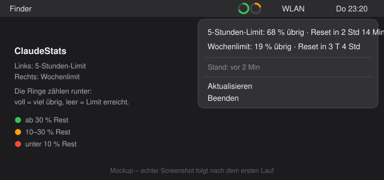
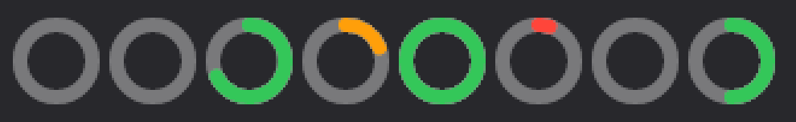

# ClaudeStats

A menu bar / tray indicator for your **Claude usage limits**. Two rings show how much of your
**5-hour limit** (left) and your **weekly limit** (right) is left. They count down: full means
plenty left, empty means the limit is reached.



Real renderings of the icon (no data, 68 %/19 %, 100 %/5 %, 0 %/50 % left):



> **Status:** early version. Built with [Avalonia UI](https://avaloniaui.net/) (C#/.NET 11),
> macOS first; the code is structured so that Windows only needs small additions.
> The menu texts are currently in German.

## How it works

No setup needed besides being logged in to **Claude Code**. ClaudeStats reads Claude Code's login
and asks Anthropic for your plan usage every 2 minutes, the same data that `/usage` shows:

```
Claude Code login ──▶ ClaudeStats ──GET api.anthropic.com/api/oauth/usage──▶ 5-hour + weekly %
```

| Where the login comes from | Platform |
|----------------------------|----------|
| Keychain item `Claude Code-credentials` | macOS |
| `~/.claude/.credentials.json` | Windows / Linux |
| Env var `CLAUDE_CODE_OAUTH_TOKEN` (overrides both) | any |

### Good to know

- Works with **Pro/Max plans** and a Claude Code login (`claude` → `/login`).
- On first launch macOS asks whether ClaudeStats may read the Keychain item
  `Claude Code-credentials`. Click **Always Allow**, otherwise you are asked again on every refresh.
- The token stays in memory and is only sent to `api.anthropic.com`. It is never written to disk or logged.
- The usage endpoint is **not officially documented**. Many tools use it, but Anthropic may change it.
- ClaudeStats does not refresh the login itself (that could log Claude Code out). If the token
  has expired because Claude Code was not used for a while, the menu says so; opening Claude Code
  once refreshes it.
- There is no daily limit in this data, so there are only two rings: 5 hours and week.

## Install (macOS)

**Option A: prebuilt package from [Releases](https://github.com/modmoto/ClaudeStats/releases).**
Download the zip that matches your Mac (`osx-arm64` = Apple Silicon, `osx-x64` = Intel), unzip it
and drag the app to `/Applications`. The app is not notarized by Apple, so allow it once:

```bash
xattr -dr com.apple.quarantine /Applications/ClaudeStats.app
open /Applications/ClaudeStats.app
```

**Option B: build it yourself.** Requires the .NET 11 SDK.

```bash
git clone https://github.com/modmoto/ClaudeStats.git
cd ClaudeStats
scripts/package-macos.sh            # picks the architecture of your Mac
cp -R publish/*/ClaudeStats.app /Applications/
open /Applications/ClaudeStats.app
```

The app runs without a Dock icon; you only find it in the menu bar. In its menu you can enable
**Beim Anmelden starten** (start at login), open the log, and quit.

### Icon not visible?

- **Full menu bar / notch:** macOS silently hides menu bar icons that do not fit, especially on
  MacBooks with a notch. Quit a few other menu bar apps, or use a tool like Ice or Bartender.
- **Log:** `~/Library/Logs/ClaudeStats/ClaudeStats.log` shows whether the tray icon was created
  and what the last fetch returned.

## Develop

Requirements: .NET 11 SDK, e.g. with JetBrains Rider. Run the `ClaudeStats` project; it shows a
Dock icon when started from the IDE (the packaged `.app` does not).

```bash
dotnet build ClaudeStats.sln
dotnet test tests/ClaudeStats.Core.Tests
dotnet run --project src/ClaudeStats
```

| Project                         | Contents                                                        |
|---------------------------------|-----------------------------------------------------------------|
| `src/ClaudeStats.Core`          | Login reading, API client, percentages/resets, texts. No UI, platform independent |
| `src/ClaudeStats`               | Avalonia app: tray icon, ring drawing, menu, log, autostart     |
| `tests/ClaudeStats.Core.Tests`  | Unit tests for the core logic                                   |
| `scripts/package-macos.sh`      | Builds `ClaudeStats.app` and a zip                              |

## Publish a release

The `.github/workflows/release.yml` pipeline runs the tests, builds `ClaudeStats.app` for Apple
Silicon and Intel on macOS runners, and creates the GitHub release with both zips and checksums.
Versions below 1.0 are automatically marked as pre-releases.

```bash
git tag v0.2.0
git push origin v0.2.0
```

Alternatively, go to **Actions → release → Run workflow** on GitHub and enter the tag.

## Roadmap

- [x] Live data from Anthropic instead of the status line
- [x] Start at login (macOS)
- [ ] Real screenshot in the README
- [ ] Percentage number next to or inside the rings
- [ ] Popover window instead of a plain menu
- [ ] Windows test, autostart and installer
- [ ] English UI texts
